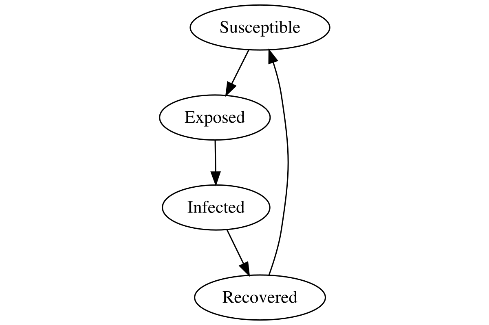

An RCPP hybrid agent-based and compartmental model.

[PositCloud](https://connect.posit.cloud/cmilando/content/019fc7fe-ccd7-53ac-83d1-473fdf4a7e76)

when you update libraries make sure to update the manifest
```
rsconnect::writeManifest()
```

then go here and update after a git push
[link](https://connect.posit.cloud/cmilando)

# RSV_sim

**An R/Rcpp hybrid agent-based and compartmental model for simulating RSV transmission in a structured population.**

[](https://cran.r-project.org/)
[](https://cran.r-project.org/package=Rcpp)
[](https://shiny.posit.co/)

---

## Overview

`RSV_sim` is a computational model for simulating respiratory syncytial virus (RSV) transmission through a synthetic population with explicit social and spatial structure.

The model combines:

* **Individual-level agents**
* **SEIR disease states**
* **Age structure**
* **Household membership**
* **Workplace membership**
* **School membership**
* **Community membership**
* **Hourly time-activity patterns**
* **Asymptomatic infection**
* **Behavioral changes during infection**
* **Environmental virus persistence**
* **Age-specific incidence and prevalence**
* **High-performance C++ simulation through Rcpp**
* **Interactive visualization through a Shiny application**

The model is designed to provide a flexible framework for exploring how individual characteristics, social mixing, movement between environments, and transmission parameters interact to produce population-level RSV epidemics.

The core simulation is implemented in C++ and exposed to R through **Rcpp**. This allows the model to retain an individual-based representation while avoiding the computational cost of performing the full simulation loop in R.

---

## Model structure

The model represents a population of individuals who interact through four types of environments:

```text
                         ┌─────────────┐
                         │  Household  │
                         └──────┬──────┘
                                │
                                │
              ┌─────────────────┼─────────────────┐
              │                 │                 │
              ▼                 ▼                 ▼
        ┌───────────┐     ┌───────────┐     ┌───────────┐
        │   Work    │     │  School   │     │ Community │
        └───────────┘     └───────────┘     └───────────┘
```

Each individual has:

* an age;
* a household ID;
* optionally a workplace ID;
* optionally a school ID;
* a community ID;
* an asymptomatic/symptomatic characteristic;
* a behavioral response to infection;
* an SEIR disease state.

The current implementation uses ages from **0–100 years** and represents each environment as a collection of individuals who can contribute to transmission within that environment.

---

## Disease model

Each individual moves through an SEIR-style state machine:

```text
        infection
 S ─────────────────► E
                      │
                      │ incubation
                      ▼
                      I
                      │
                      │ recovery
                      ▼
                      R
```

The four disease states are:

| State       | Code | Description                     |
| ----------- | ---: | ------------------------------- |
| Susceptible |  `0` | Individual can become infected  |
| Exposed     |  `1` | Infected but not yet infectious |
| Infected    |  `2` | Currently infected              |
| Recovered   |  `3` | Recovered from infection        |

The state-transition logic is implemented in `get_timeseries.cpp`. Susceptible individuals can become exposed when they encounter an infectious environment; exposed individuals subsequently progress to infection and then recovery.

The repository also contains `create_state_diagram.R`, which programmatically extracts the disease-state transitions from the C++ source and generates `diagram.png`. This is intended to keep the conceptual state diagram synchronized with the implementation.



---

# Simulation architecture

The model can be thought of as three major components:

```text
                 ┌─────────────────────┐
                 │  Synthetic          │
                 │  Population         │
                 │  Construction       │
                 └──────────┬──────────┘
                            │
                            ▼
                 ┌─────────────────────┐
                 │  Social/contact     │
                 │  structure          │
                 │                     │
                 │ HH / Work / School  │
                 │ / Community         │
                 └──────────┬──────────┘
                            │
                            ▼
                 ┌─────────────────────┐
                 │  Hourly RSV         │
                 │  transmission       │
                 │  simulation         │
                 │      (Rcpp/C++)     │
                 └──────────┬──────────┘
                            │
                            ▼
                 ┌─────────────────────┐
                 │  Epidemiological    │
                 │  outputs            │
                 │                     │
                 │ incidence           │
                 │ prevalence          │
                 │ infection history   │
                 │ location            │
                 └─────────────────────┘
```

The repository separates these components into population-generation, contact-matrix, simulation, and visualization code.

---

# Synthetic population

## Population generation

`00_build_population.R` constructs the synthetic population.

The current example uses:

```r
N <- 1e5
```

so that the demonstration population contains **100,000 individuals**.

Age is sampled from the **2024 U.S. Census national age-sex estimates**, using the total population across sexes and ages 0–100. The Census data are stored locally in:

```text
nc-est2024-agesex-res.csv
```

The resulting age distribution is sampled probabilistically to create the synthetic population.

### Population variables

The basic population table contains:

```text
person_id
age
household_id
work_id
school_id
community_id
```

Additional individual characteristics are subsequently added for simulation:

```text
asymptomatic
stays_home
infected
```

The population is stored as:

```text
demo_pop.RDS
```

---

## Households

Household sizes are currently generated using a Poisson distribution:

```r
household_sizes <- rpois(N, 3) + 1
```

The population is then assigned to households using an Rcpp implementation.

The current household assignment also uses age groups, with the implementation designed to distribute individuals across household structures rather than simply assigning completely random groups.

---

## Workplaces

Workplace membership is generated using:

```r
work_sizes <- rpois(N, 20) + 1
```

Individuals between ages **20–64** are eligible for workplace assignment in the current population-building implementation.

Individuals outside this age range receive no workplace assignment.

---

## Schools

School membership is generated using:

```r
school_sizes <- rpois(N, 50) + 1
```

Individuals ages **0–19** are eligible for school assignment.

---

## Communities

Community membership is initially generated using:

```r
community_size_true <- rpois(N, 50) + 1
```

The community-size structure is subsequently investigated in `00_find_community_size.R`.

That script compares the contact structure generated under alternative community sizes against the "true" contact matrix generated from the initial synthetic population. The comparison uses mean squared deviation between the resulting total contact matrices.

This provides a mechanism for calibrating or selecting a community-size parameter while preserving the age-specific contact structure generated by the more detailed synthetic population.

---

# Contact matrices

`contact_matrix.cpp` converts the individual-level population structure into age-specific contact matrices.

For each of the four environments, the model calculates contacts between:

```text
reference age × contact age
```

for:

* household;
* workplace;
* school;
* community.

The resulting output contains:

```text
ref_age
nref
contact_age
household
community
school
work
total
```

The age dimension currently runs from **0 to 100**, producing a 101 × 101 age-contact structure.

The contact matrices are constructed directly from the individual-level membership IDs. For example, household contacts are generated by identifying everyone belonging to the same household and removing the individual themselves from their own contact count.

This allows the model to retain the advantages of an agent-based population while also providing a direct representation of the resulting population mixing structure.

---

# Time-activity model

Transmission occurs on an **hourly timestep**.

The current model uses a 24-hour activity schedule describing when individuals are present in different environments.

The demonstration schedule includes:

* nighttime/home;
* work;
* school;
* community.

For example, the current demonstration assigns daytime hours to workplace or school environments depending on an individual's group membership.

The activity matrix has the general structure:

```text
hour   work   school   community
0       ...     ...       ...
1       ...     ...       ...
...
23      ...     ...       ...
```

These activity patterns determine the environment in which an individual participates at each timestep.

---

# Transmission model

The primary simulation function is:

```cpp
get_timeseries()
```

implemented in:

```text
get_timeseries.cpp
```

and exposed to R using Rcpp.

The function accepts:

```text
population matrix
time-activity matrix
number of simulation days
transmission probability
virus decay duration
incubation duration
recovery duration
IDs to track
```

and returns the epidemiological time series generated by the simulation.

---

## Environmental transmission

The model explicitly represents four types of `MicroEnvironment`:

```text
Household
Workplace
School
Community
```

Each environment has:

* an ID;
* a location type;
* a virus-decay duration;
* a collection of participating individuals.

The four location codes are:

```text
0 = Household
1 = Work
2 = School
3 = Community
```

Individuals are added to the appropriate environment based on their membership IDs.

This provides the model with an explicit mechanism for infection to persist within an environment and affect subsequent individuals who enter that environment.

---

# Agent representation

Each simulated person is represented as a C++ `Person` object.

The object contains, among other characteristics:

* person ID;
* age;
* household ID;
* workplace ID;
* school ID;
* community ID;
* asymptomatic status;
* stay-home behavior;
* time-activity pattern;
* transmission probability;
* incubation duration;
* recovery duration;
* waning/recovery duration.

The current implementation uses a 365-timestep waning-recovery parameter when constructing the `Person` object.

---

# Infection dynamics

The core infection logic is implemented in the `Person` state-update methods within `get_timeseries.cpp`.

A susceptible person transitions to the exposed state when they are in an environment containing infectious material. The model then progresses individuals through the exposed, infected, and recovered states according to the specified disease-duration parameters.

The primary transmission parameter is:

```r
transmission_probability
```

while disease progression is controlled by:

```r
virus_decay_days
incubation_days
recovery_days
```

The demonstration scripts currently use:

```r
transmission_probability = 0.00125
virus_decay_days = 3
incubation_days = 3
recovery_days = 3
```

for the standalone time-series example.

The Shiny application exposes the transmission probability and selected population parameters interactively.

---

# Behavioral heterogeneity

The model includes two individual-level behavioral characteristics.

## Asymptomatic infection

Individuals can be assigned an asymptomatic characteristic:

```r
pop_df$asymptomatic
```

The standalone demonstration currently assigns:

```r
runif(nrow(pop_df)) < 0.1
```

corresponding to a 10% demonstration prevalence.

The Shiny application allows this proportion to be changed.

---

## Staying home while sick

Individuals also have a `stays_home` characteristic.

The standalone demonstration currently uses:

```r
runif(nrow(pop_df)) < 0.8
```

corresponding to 80% in the demonstration.

The Shiny application allows this parameter to be modified.

This provides a simple mechanism for representing behavioral changes associated with infection.

---

# Initial infections

The model allows the initial infection seed to be specified in two ways.

### Random seeding

A specified percentage of the population is selected at random.

### Community-based seeding

The same approximate number of initial infections is sampled from individuals belonging to:

```text
community_id == 0
```

The Shiny interface allows users to switch between these two approaches.

This distinction makes it possible to explore the difference between geographically/socially localized introductions and randomly distributed introductions.

---

# Simulation outputs

The simulation returns several types of epidemiological and tracking data.

## Individual SEIR status

For tracked individuals:

```text
person_seir
```

records the SEIR state through time.

The state values are:

```text
0 = Susceptible
1 = Exposed
2 = Infected
3 = Recovered
```

---

## Individual location

For tracked individuals:

```text
person_location
```

records the individual's current environment.

The location states are:

```text
0 = Household
1 = Work
2 = School
3 = Community
```

---

## Environment infection

The simulation tracks infection dynamics within selected:

* households;
* workplaces;
* schools;
* communities.

This allows the user to inspect how infections propagate through the social structure.

---

## Age-specific incidence

The model records:

```text
incidence
```

by age and timestep.

Incidence represents the number of new infections occurring during each timestep.

---

## Age-specific prevalence

The model also records:

```text
prevalence
```

by age and timestep.

This represents the number of currently infected individuals at each timestep.

---

## Cumulative infection

The model tracks:

```text
p_ever_infected
```

which represents the proportion of the population that has experienced infection up to each timestep.

---

# Shiny application

The repository includes an interactive Shiny application in:

```text
app.R
```

The application is titled **RSV Tracking** and provides an interface for configuring and running the simulation.

## Launching the application

From the repository directory:

```r
shiny::runApp()
```

or:

```r
shiny::runApp("app.R")
```

The application can also be launched directly from RStudio by opening `app.R` and selecting **Run App**.

---

## Shiny controls

The current application exposes the following parameters.

### Simulation duration

```text
Simulation days
```

Default:

```text
50 days
```

Current allowed range:

```text
1–100 days
```

---

### Transmission probability

```text
Transmission probability
```

Default:

```text
0.04
```

Range:

```text
0–1
```

This parameter is passed directly to the C++ transmission model.

---

### Initial infection prevalence

```text
Percent initially infected
```

Default:

```text
2%
```

The application allows initial infections to be randomly distributed or concentrated in community 0.

---

### Asymptomatic infection

```text
Percent asymptomatic
```

Default:

```text
10%
```

---

### Staying home while sick

```text
Percent stays home when sick
```

Default:

```text
80%
```

---

### Random seed

```text
Seed
```

A fixed seed can be specified to make stochastic simulation results reproducible.

The application sets the R random seed before generating the stochastic population characteristics and initial infections.

---

# Shiny outputs

The application currently provides two groups of plots.

## Tracked plots

The **Tracked plots** tab displays detailed simulation trajectories for individuals and their associated social environments.

The current implementation tracks people in the first several households together with their associated:

* households;
* workplaces;
* schools;
* communities.

These plots are useful for understanding the model mechanistically rather than only examining population-level epidemic curves.

---

## Diagnostic plots

The **Diagnostic plots** tab provides population-level model diagnostics.

The underlying plotting code includes:

* incidence;
* prevalence;
* infection location;
* cumulative proportion ever infected.

---

# Repository structure

```text
RSV_sim/
│
├── 00_build_population.R
├── 00_find_community_size.R
├── 01_timeseries.R
│
├── app.R
│
├── contact_matrix.cpp
├── get_timeseries.cpp
├── set_ids.cpp
│
├── create_state_diagram.R
│
├── demo_pop.RDS
├── nc-est2024-agesex-res.csv
├── track.json
├── diagram.png
│
├── manifest.json
├── RSV_sim.Rproj
└── .gitignore
```

---

## File descriptions

### `00_build_population.R`

Constructs the synthetic population.

Major steps include:

1. Loading the Census age distribution.
2. Sampling individual ages.
3. Generating household sizes.
4. Generating workplace sizes.
5. Generating school sizes.
6. Generating community sizes.
7. Assigning individuals to social groups.
8. Saving the resulting population to `demo_pop.RDS`.

The ID-assignment operations are implemented in C++ for performance.

---

### `00_find_community_size.R`

Investigates the community-size parameter.

The script:

1. Constructs a detailed contact matrix from the synthetic population.
2. Creates alternative populations with specified community sizes.
3. Calculates corresponding age-specific contact matrices.
4. Compares those matrices against the detailed reference matrix.
5. Uses mean squared deviation as the comparison metric.

This script is primarily a model-development/calibration tool rather than a required step for every simulation.

---

### `01_timeseries.R`

Runs the model outside of Shiny.

This is the best place to examine the simulation programmatically.

The script:

1. Loads `demo_pop.RDS`.
2. Adds asymptomatic and behavioral characteristics.
3. Seeds initial infections.
4. Creates a 24-hour activity schedule.
5. Selects individuals/environments to track.
6. Compiles `get_timeseries.cpp` through Rcpp.
7. Runs the simulation.
8. Produces tracked and diagnostic plots.

---

### `app.R`

Interactive Shiny interface for running the model.

It contains both the user interface and server logic and calls the same underlying C++ simulation used by the standalone workflow.

---

### `contact_matrix.cpp`

Rcpp implementation for calculating age-specific contact matrices from individual-level group membership.

It calculates separate matrices for:

```text
Household
Work
School
Community
Total
```

---

### `get_timeseries.cpp`

Core simulation engine.

This is the main computational component of the model.

It:

* creates `Person` agents;
* creates environmental objects;
* assigns individuals to environments;
* simulates hourly disease dynamics;
* handles disease-state transitions;
* tracks environmental infection;
* calculates incidence and prevalence;
* records selected individuals and environments.

The primary exported function is:

```cpp
get_timeseries()
```

---

### `set_ids.cpp`

C++ implementation of the algorithms used to assign individuals to households, workplaces, schools, and communities.

The exported functions include:

```r
set_ids_cpp()
```

and related single-group assignment functions.

The use of C++ here is intended to make assignment of large synthetic populations substantially faster than repeatedly performing equivalent operations in R.

---

### `create_state_diagram.R`

Automatically extracts SEIR transitions from `get_timeseries.cpp` and creates the state diagram.

This is useful because the diagram is derived from the model implementation rather than being maintained independently.

---

### `demo_pop.RDS`

Serialized demonstration population generated by `00_build_population.R`.

This allows the simulation and Shiny application to start from a pre-built population without reconstructing the synthetic population every time.

---

### `track.json`

Stores IDs used for tracking selected people and environments in the model.

The standalone workflow constructs tracking lists containing:

```text
person_IDs
household_IDs
work_IDs
school_IDs
comm_IDs
```

---

### `nc-est2024-agesex-res.csv`

U.S. Census 2024 national age-sex population estimates used to construct the synthetic age distribution.

---

### `diagram.png`

Generated visualization of the SEIR state machine.

---

### `manifest.json`

Package manifest used for deployment of the Shiny application through Posit Connect/Posit Cloud.

When R package dependencies change, regenerate the manifest with:

```r
rsconnect::writeManifest()
```

The current repository README notes that the manifest should be updated when libraries are changed.

---

# Installation

## Requirements

The model requires:

* R
* a working C++ compiler
* Rcpp
* the R packages used by the simulation and Shiny application.

The model uses Rcpp's `sourceCpp()` mechanism, so a functioning local C++ toolchain is required when compiling the C++ source files.

---

## R packages

The Shiny application currently uses packages including:

```r
shiny
jsonlite
data.table
ggplot2
ggpubr
bslib
svglite
patchwork
Rcpp
```

Install them with:

```r
install.packages(c(
  "shiny",
  "jsonlite",
  "data.table",
  "ggplot2",
  "ggpubr",
  "bslib",
  "svglite",
  "patchwork",
  "Rcpp"
))
```

For development of the state diagram, additional packages are used:

```r
install.packages(c(
  "DiagrammeR",
  "DiagrammeRsvg",
  "rsvg"
))
```

---

# Quick start

## 1. Clone the repository

```bash
git clone https://github.com/cmilando/RSV_sim.git
cd RSV_sim
```

## 2. Open the project

Open:

```text
RSV_sim.Rproj
```

in RStudio, or set the working directory manually:

```r
setwd("/path/to/RSV_sim")
```

---

## 3. Run the Shiny application

```r
shiny::runApp()
```

The application will launch with the default model settings.

---

# Running the model programmatically

For users interested in modifying or extending the model, the standalone workflow is preferable to the Shiny application.

Start with:

```r
source("01_timeseries.R")
```

The script ultimately calls:

```r
out <- get_timeseries(
  df_mat,
  ta_mat,
  n_days = 100,
  transmission_probability = 0.00125,
  virus_decay_days = 3,
  incubation_days = 3,
  recovery_days = 3,
  personIDs_to_track = as.integer(track$person_IDs),
  hhIDs_to_track = as.integer(track$household_IDs),
  workIDs_to_track = as.integer(track$work_IDs),
  schoolIDs_to_track = as.integer(track$school_IDs),
  commIDs_to_track = as.integer(track$comm_IDs)
)
```

---

# Input data structure

The C++ simulation expects the population to be supplied as an integer matrix.

The columns currently correspond to:

| Column | Variable       | Description                             |
| -----: | -------------- | --------------------------------------- |
|      1 | `person_id`    | Unique person identifier                |
|      2 | `age`          | Age, 0–100                              |
|      3 | `household_id` | Household membership                    |
|      4 | `work_id`      | Workplace membership                    |
|      5 | `school_id`    | School membership                       |
|      6 | `community_id` | Community membership                    |
|      7 | `asymptomatic` | Whether infection is asymptomatic       |
|      8 | `stays_home`   | Whether person stays home when infected |

The C++ simulation reads these columns directly when constructing its `Person` objects.

This means that modifications to the population data structure should be made carefully: changing column order or adding/removing columns requires corresponding changes to the C++ implementation.

---

# Time-activity input

The simulation also accepts a 24-hour activity matrix.

The current representation uses:

```text
hour
work_location
school_location
comm_location
```

with one row for each hour of the day.

This structure provides a relatively simple mechanism for experimenting with alternative daily schedules.

For example, the activity schedule could eventually be modified to represent:

* different work schedules;
* weekends;
* holidays;
* school closures;
* remote work;
* altered community activity;
* age-specific schedules;
* intervention scenarios.

---

# Performance

A central design goal of `RSV_sim` is to combine the flexibility of an agent-based model with the computational efficiency of compiled C++.

The model therefore uses R for:

* population construction;
* configuration;
* visualization;
* analysis;
* interactive controls;

while using C++ for the computationally intensive simulation and population operations.

The current implementation creates explicit `Person` objects and environmental lookup structures in C++, and preallocates tracking matrices for the simulation period.

This architecture is particularly useful for large populations and long simulations where an equivalent R-only implementation would require substantially more computational time.

---

# Reproducibility

The simulation is stochastic.

Randomness enters through several stages, including:

* age sampling;
* social-group assignment;
* asymptomatic status;
* stay-home behavior;
* initial infection assignment;
* transmission events.

The scripts use explicit random seeds to facilitate reproducibility.

For example:

```r
set.seed(1234)
```

is used during population construction, while the Shiny application allows the user to specify the random seed directly.

For reproducible analyses, record:

1. the Git commit;
2. the random seed;
3. population size;
4. simulation duration;
5. transmission parameters;
6. disease-duration parameters;
7. population-generation parameters;
8. activity schedule.

---

# Model parameters

The principal model parameters are summarized below.

| Parameter                  | Description                                                   |
| -------------------------- | ------------------------------------------------------------- |
| `N`                        | Synthetic population size                                     |
| `transmission_probability` | Probability associated with transmission                      |
| `virus_decay_days`         | Duration of infectious material persistence in an environment |
| `incubation_days`          | Duration of the exposed state                                 |
| `recovery_days`            | Duration of the infected state                                |
| `p_initInfect`             | Percentage initially infected                                 |
| `p_asymptomatic`           | Percentage asymptomatic                                       |
| `p_staysHome`              | Percentage staying home while sick                            |
| `n_days`                   | Simulation duration                                           |
| `seed`                     | Random-number seed                                            |

The Shiny application exposes the principal behavioral and transmission parameters while keeping the current disease-duration parameters fixed at three days for incubation and recovery and three days for environmental virus decay.

---

# Model outputs for analysis

A typical simulation produces data that can be used to investigate:

### Epidemic dynamics

* incidence through time;
* prevalence through time;
* cumulative infection;
* epidemic timing;
* epidemic duration.

### Age patterns

* age-specific incidence;
* age-specific prevalence;
* differences in infection burden across age groups.

### Social environments

* household transmission;
* workplace transmission;
* school transmission;
* community transmission.

### Individual trajectories

* individual SEIR states;
* individual movement between environments;
* infection histories.

### Spatial/social seeding experiments

The current infection-seeding options allow comparisons between:

```text
Random introduction
```

and

```text
Community-localized introduction
```

---

# Development workflow

A typical development workflow is:

```text
1. Modify population structure
          │
          ▼
2. Rebuild demo_pop.RDS
          │
          ▼
3. Examine contact matrix
          │
          ▼
4. Modify C++ transmission model
          │
          ▼
5. Run 01_timeseries.R
          │
          ▼
6. Inspect diagnostic plots
          │
          ▼
7. Test through Shiny
          │
          ▼
8. Update state diagram if disease
   transitions have changed
```

---

# Updating the population

To regenerate the demonstration population:

```r
source("00_build_population.R")
```

This recreates:

```text
demo_pop.RDS
```

from the Census age distribution and the current population-generation parameters.

---

# Updating the contact structure

To investigate the relationship between community size and the resulting age-specific contact matrix:

```r
source("00_find_community_size.R")
```

The script calculates a reference contact matrix and then evaluates alternative community configurations using mean squared deviation.

---

# Updating the state diagram

After changing disease-state transitions in:

```text
get_timeseries.cpp
```

regenerate the state diagram with:

```r
source("create_state_diagram.R")
```

The script reads the C++ source, extracts assignments to `SEIR_status`, constructs the state-transition graph, and writes:

```text
diagram.png
```

---

# Deployment

The Shiny application is configured for deployment through Posit infrastructure.

The repository currently includes:

```text
manifest.json
```

for dependency management.

After changing R package dependencies, regenerate the manifest:

```r
rsconnect::writeManifest()
```

and update the deployed application after pushing the changes to GitHub.

---

# Current model assumptions

The current implementation should be considered a **model-development framework** rather than a fully calibrated RSV forecasting model.

Important assumptions in the current implementation include:

* synthetic rather than empirically observed individuals;
* simplified social-group size distributions;
* simplified daily activity schedules;
* simplified infection progression;
* a single transmission probability;
* simplified environmental persistence;
* simplified behavioral response to infection;
* no explicit demographic turnover during the simulation;
* no explicit births or deaths during a simulation;
* no explicit vaccination mechanism in the current implementation;
* no explicit age-dependent susceptibility parameter in the current interface.

These assumptions are useful for keeping the model tractable and interpretable, but they should be considered when interpreting simulation results.

---

# Extending the model

The architecture is intended to make several extensions possible.

Potential extensions include:

## More realistic population structure

Replace the current synthetic group-size distributions with empirical distributions from:

* Census;
* ACS;
* school enrollment data;
* employment data;
* household surveys.

## More detailed activity patterns

Introduce:

* weekday/weekend schedules;
* holidays;
* school calendars;
* remote work;
* age-specific activity;
* occupation-specific activity.

## RSV natural history

Potential additions include:

* age-dependent incubation;
* age-dependent infectiousness;
* age-dependent susceptibility;
* waning immunity;
* reinfection;
* partial immunity;
* maternal immunity;
* vaccination.

## Intervention scenarios

The framework could be extended to evaluate:

* vaccination;
* school closures;
* isolation;
* reduced workplace attendance;
* changes in community activity;
* targeted interventions.

## More detailed environmental transmission

The existing environment representation provides a foundation for more explicit:

* aerosol persistence;
* ventilation;
* environmental contamination;
* environmental-specific transmission probabilities;
* exposure duration.

---

# Computational design

The model intentionally uses a hybrid architecture.

```text
                         R
                         │
             ┌───────────┼───────────┐
             │           │           │
             ▼           ▼           ▼
        Population   Parameters   Visualization
        generation                 & Shiny
             │
             ▼
           Rcpp
             │
             ▼
       ┌──────────────┐
       │     C++      │
       │              │
       │ Agents       │
       │ Environments │
       │ Transmission │
       │ Tracking     │
       └──────────────┘
```

This separation makes it possible to modify population assumptions and visualization in R without rewriting the computational engine, while keeping the expensive agent-level simulation in compiled C++.

---

# Citation

If you use this model in research, please cite the repository:

```bibtex
@software{milando_rsv_sim,
  author  = {Milando, Chad},
  title   = {RSV\_sim: An R/Rcpp Hybrid Agent-Based and Compartmental Model},
  url     = {https://github.com/cmilando/RSV_sim},
  year    = {2026}
}
```

If the model becomes associated with a specific manuscript or publication, the publication citation should be used in addition to or instead of this software citation.

---

# License

A license is not currently specified in the repository.

Before redistributing or incorporating this code into another project, add an explicit open-source license to the repository (for example, MIT, BSD-3-Clause, or GPL-3) if that is consistent with the intended use.

---

# Status

This repository is under active development.

The current version is best viewed as a research and model-development framework. Model parameters, population-generation assumptions, transmission mechanisms, and disease natural-history assumptions may change as the model is developed and calibrated.

For the most current implementation, refer to the `main` branch:

**https://github.com/cmilando/RSV_sim**
